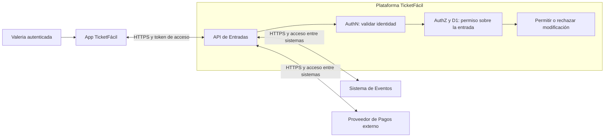

# Simulacro de evaluación parcial, caso TicketFácil

## Propósito y fuente

Práctica publicada en la semana 7 mediante la presentación **Simulacro_ san-miguel.pptx**, de 18 diapositivas. Integra el recorrido de las primeras seis clases: entender el AS-IS, analizar riesgo, justificar una decisión, identificar la API crítica, proteger acceso y datos y representar el TO-BE.

Las respuestas siguientes son **referenciales del docente**, reorganizadas para estudiar. Las consignas del simulacro son contenido académico; no ordenan operar una aplicación real ni entregar una evaluación.

## 1. Escenario de negocio

Valeria utiliza la App TicketFácil para comprar entradas para conciertos y otros eventos:

1. Inicia sesión y selecciona evento, fecha y ubicación.
2. La App envía la solicitud al Sistema de Entradas.
3. El Sistema de Entradas consulta disponibilidad en el Sistema de Eventos.
4. Al confirmar la compra, solicita el cobro al Proveedor de Pagos externo.
5. Si el pago es aprobado, se genera una entrada con código QR.
6. La entrada queda disponible en la App para Valeria.

| Participante o componente | Responsabilidad |
|---|---|
| Valeria | Cliente que compra y solicita modificar su entrada |
| App TicketFácil | Interfaz y consumidor de servicios |
| Sistema de Entradas | Gestión de compras, entradas y modificaciones |
| Sistema de Eventos | Eventos, fechas y disponibilidad |
| Proveedor de Pagos | Procesamiento externo del cobro |

### Condición que inicia el análisis

La App permite cambiar la fecha de una entrada usando su código. Valeria **ya inició sesión correctamente**, pero la API procesa el cambio sin comprobar suficientemente que esa entrada pertenece al usuario autenticado.

El problema observado es el control de autorización sobre una entrada concreta. El simulacro mantiene esa misma evidencia durante las cuatro rondas; el login no necesita ser rediseñado para explicar esta condición.

## 2. Recorrido de las cuatro rondas

| Ronda | Pregunta | Resultado esperado |
|---|---|---|
| 1. Entender y analizar | ¿Qué ocurre y qué puede salir mal? | Integración AS-IS y riesgo R1 |
| 2. Decidir e identificar API | ¿Qué decisión reduce R1 y dónde se aplica? | Decisión D1 y API crítica |
| 3. Proteger el acceso | ¿Quién accede y qué puede hacer sobre este recurso? | AuthN, AuthZ, permiso y restricción |
| 4. Proteger e integrar | ¿Qué datos circulan, cómo se protegen y cómo queda la arquitectura? | Matriz de datos y TO-BE coherente |

La trazabilidad es: **evidencia → R1 → dimensión CIA → principio → D1 → API → AuthN/AuthZ → datos y protección → TO-BE**.

## 3. Ronda 1: entender el AS-IS y construir R1

La primera actividad pide identificar participantes, integraciones, información intercambiada y propósito del proceso. Después se distinguen activo, amenaza, vulnerabilidad, escenario de riesgo e impacto. La lámina propone 8 a 10 minutos y pospone los controles hasta comprender el riesgo.

### Integración: respuesta referencial

| Elemento | Referencia del docente |
|---|---|
| Integración afectada | App TicketFácil con Sistema de Entradas para modificar la fecha |
| Productor y consumidor | Solicitud: App → Sistema de Entradas. Respuesta: Sistema de Entradas → App |
| Información | Código de entrada, fecha actual y nueva fecha solicitada |
| Propósito | Cambiar la fecha de una entrada ya adquirida |

La dirección productor/consumidor debe explicarse por mensaje: el emisor de la solicitud no necesariamente será el emisor de la respuesta.

### Riesgo R1: respuesta referencial

| Elemento | Referencia del docente |
|---|---|
| Manifestación | La API acepta cambiar la fecha sin verificar suficientemente la pertenencia de la entrada |
| Activo | Exactitud y consistencia de los datos de la entrada |
| Amenaza | Modificación no autorizada de su fecha |
| Vulnerabilidad | Comprobación insuficiente de autorización sobre la entrada antes del cambio |
| Escenario R1 | Un usuario autenticado modifica, mediante el código, la fecha de una entrada ajena porque la API no valida su autorización sobre ese recurso |
| Impacto | Alteración no autorizada de información; principalmente afecta la integridad |

**Amenaza, vulnerabilidad y riesgo describen cosas diferentes.** La amenaza expresa el evento adverso; la vulnerabilidad es la debilidad que lo permite; el riesgo conecta evento, debilidad, activo y consecuencia.

La consigna también menciona determinar el nivel de riesgo. La respuesta referencial mostrada no aporta una escala de probabilidad e impacto ni una puntuación numérica; esta nota conserva ese dato como pendiente de la metodología utilizada.

## 4. Ronda 2: decisión D1 y API crítica

### Plantilla para practicar sin mirar la respuesta

| Campo | Qué debe justificar |
|---|---|
| R1 | Escenario identificado en la ronda 1 |
| CIA | Propiedad principalmente afectada |
| Principio | Razón de diseño que guía la decisión |
| D1 | Qué se cambia o incorpora |
| Ubicación | Componente y operación donde se aplica |
| Justificación | Relación entre principio, decisión y reducción de R1 |
| API crítica | Nombre, propósito, proveedor, consumidor y relevancia |

La plantilla ofrece como principios mínimo privilegio, separación de responsabilidades, reducción de superficie, defensa en profundidad, simplicidad y aislamiento. Se elige y justifica el que responde al riesgo observado.

### Respuesta referencial

| Campo | Referencia del docente |
|---|---|
| CIA | Integridad |
| Principio | Mínimo privilegio |
| D1 | Validar autorización por recurso antes de modificar la fecha; comprobar que la entrada pertenece al usuario autenticado |
| Ubicación | API de Entradas, dentro del Sistema de Entradas, antes de procesar la modificación |
| Justificación | Conocer el código deja de ser suficiente: solo el usuario autorizado sobre la entrada puede modificarla |
| API crítica | API de Entradas |
| Propósito | Modificar la fecha de una entrada |
| Proveedor | Sistema de Entradas o servicio de entradas |
| Consumidor | App TicketFácil |
| Relevancia | Es el punto de solicitud de la modificación y de comprobación de autorización |

Todavía se completa el razonamiento y las decisiones; el diagrama final aparece en la ronda 4.

## 5. Ronda 3: AuthN y AuthZ

| Concepto | Pregunta aplicada al caso |
|---|---|
| Autenticación, AuthN | ¿Qué identidad realiza la solicitud y cómo la reconoce la API? |
| Autorización, AuthZ | ¿Puede esa identidad modificar la fecha de esta entrada? |

Tener una sesión válida no concede permiso sobre todas las entradas.

### Respuesta referencial

| Campo | Referencia del docente |
|---|---|
| Identidad | Valeria, previamente autenticada en TicketFácil |
| AuthN | La API valida el token o contexto recibido para reconocer la identidad autenticada |
| Mecanismo marcado en la lámina | OAuth 2.0 / OIDC |
| Permiso | Modificar sus propias entradas cuando la operación esté permitida |
| Restricción | No modificar entradas de otro usuario aunque conozca su código |
| Regla de AuthZ | El usuario solo modifica una entrada sobre la que está autorizado |
| Justificación | AuthN reconoce a Valeria; AuthZ comprueba su autorización sobre la entrada solicitada |

**Precisión conceptual:** la lámina agrupa OAuth 2.0 y OIDC en una opción. OAuth 2.0 organiza autorización delegada; OIDC añade una capa de identidad. Un token aceptado por la API debe validarse según el diseño y el tipo de token. La autorización por objeto sigue siendo necesaria después de reconocer la identidad.

El diagrama de referencia también muestra scopes en el acceso de la App. Un scope general de modificación no demuestra por sí solo que la entrada concreta pertenezca al usuario.

## 6. Ronda 4: proteger los datos

Primero se identifica el dato, su tipo y sensibilidad; luego se formula el riesgo en tránsito y la necesidad CIA. Finalmente se selecciona y justifica el control.

### Opciones de apoyo del ejercicio

| Campo | Opciones de la presentación |
|---|---|
| Tipo | Personal, transaccional, credencial/token, negocio o técnico |
| Sensibilidad | Pública, interna, confidencial o restringida/crítica |
| Riesgo en tránsito | Interceptación, modificación, suplantación o exposición |
| Necesidad | Confidencialidad, integridad o disponibilidad |
| Control | TLS/HTTPS, certificados/PKI, cifrado, firma digital o combinación justificada |

### Respuesta referencial

| Dato | Tipo | Sensibilidad | Riesgo en tránsito | Necesidad | Control y razón |
|---|---|---|---|---|---|
| Fecha de la entrada | Transaccional | Confidencial | Modificación | Integridad | TLS/HTTPS para protegerla durante la comunicación |
| Estado de la entrada | Transaccional | Confidencial | Modificación | Integridad | TLS/HTTPS para evitar alteraciones en el canal |

La clasificación y selección anteriores pertenecen al escenario docente. En otro sistema deben justificarse con su contexto.

**Relación entre controles:** TLS protege el canal; la comprobación de autorización protege la operación sobre el recurso. Una solicitud no autorizada puede llegar por un canal cifrado, por lo que ambas decisiones deben representarse.

## 7. TO-BE final

El TO-BE representa las decisiones ya justificadas. La presentación diferencia tres límites: usuario/App, plataforma TicketFácil interna y sistemas relacionados, incluido el proveedor de pagos externo.

El diagrama resume el material. Las conexiones a Eventos y Pagos representan el ecosistema del caso; la modificación de fecha no implica por sí misma ejecutar nuevamente un cobro.

### Controles identificados en la lámina final

1. **D1:** validar autorización sobre la entrada antes del cambio.
2. **API crítica:** API de Entradas dentro del Sistema de Entradas.
3. **AuthN:** validación de la identidad mediante el token recibido.
4. **AuthZ:** comprobación de autorización para la operación sobre la entrada solicitada.
5. **Protección de datos:** HTTPS/TLS en las comunicaciones analizadas.

Las relaciones con Eventos y Pagos se rotulan también con autenticación del sistema y autorización de operaciones. La leyenda distingue flujos API, límites de confianza, componentes con controles y decisiones numeradas.

La revisión final consiste en comprobar si el gráfico permite localizar cada decisión sustentada en las matrices. Incorporar un control nuevo al dibujar exige justificarlo y actualizar las decisiones previas para conservar la coherencia.

## 8. Cómo estudiar el caso

1. Leer únicamente el escenario y la condición inicial.
2. Completar las plantillas de R1, D1/API, AuthN/AuthZ y datos.
3. Dibujar el TO-BE con los mismos componentes y datos.
4. Comparar con las respuestas referenciales.
5. Explicar verbalmente por qué cada paso conduce al siguiente.

Preguntas de repaso:

- ¿Por qué iniciar sesión correctamente no evita modificar una entrada ajena?
- ¿Cuál es el activo y por qué la integridad es la dimensión principal?
- ¿Qué diferencia hay entre conocer un identificador y tener autorización?
- ¿En qué componente y momento debe aplicarse D1?
- ¿Por qué un scope general y TLS no reemplazan la comprobación por recurso?
- ¿Dónde se observan en el TO-BE los controles que figuran en las matrices?
- ¿Qué información falta para asignar un nivel numérico a R1?

## Conexiones

- [[Riesgos y vulnerabilidades en integraciones]]
- [[Security by Design y arquitectura TO BE]]
- [[Autenticación, autorización y gestión de identidades en APIs]]
- [[Protección de datos durante la integración]]
- [[Dinámicas de integración, acceso y protección de datos]]
- [[Índice de Seguridad de Integración de Aplicaciones]]
